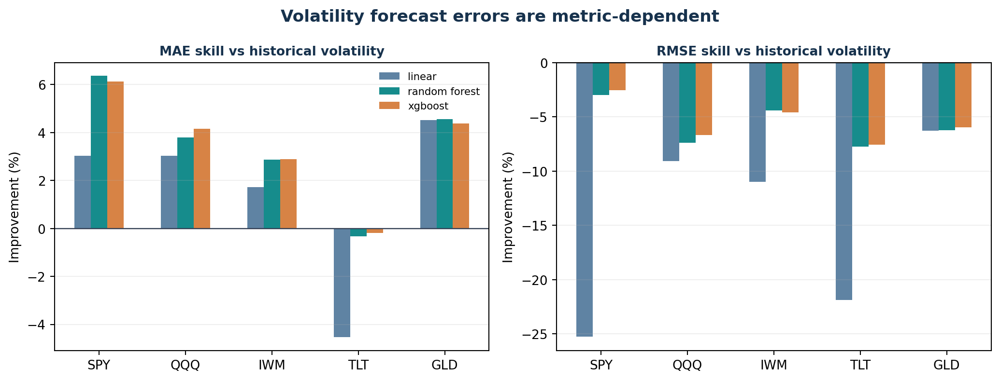
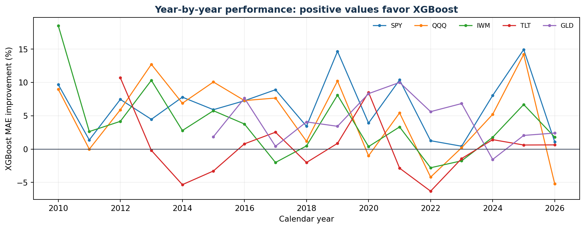
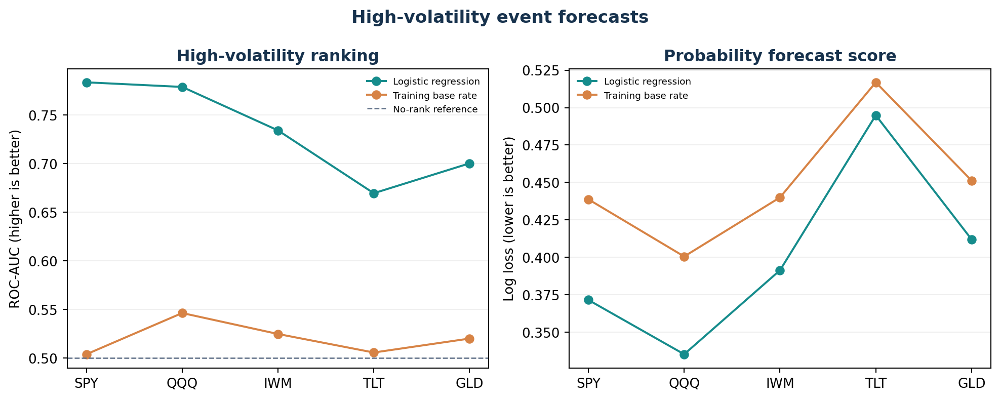
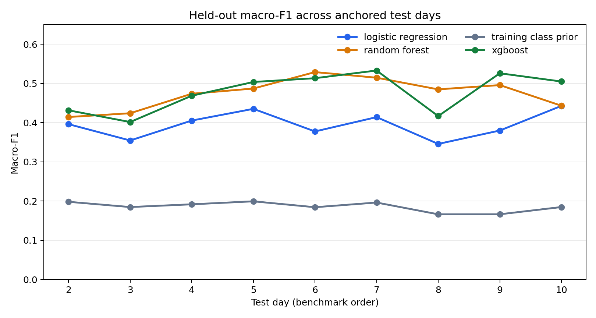
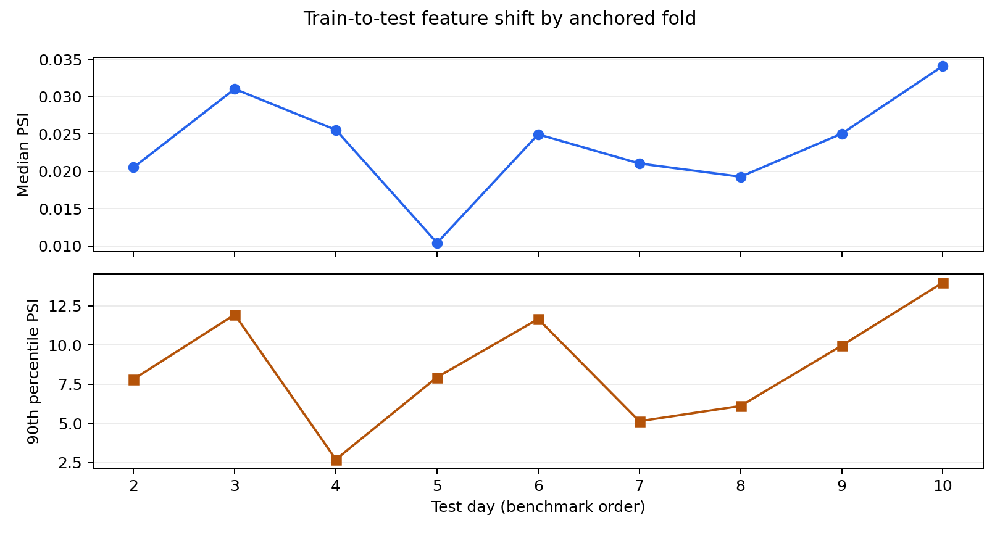
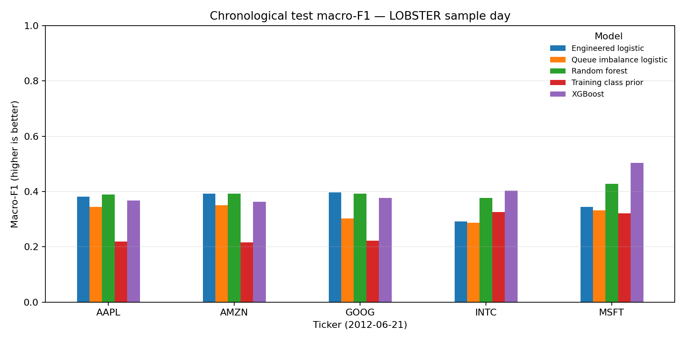
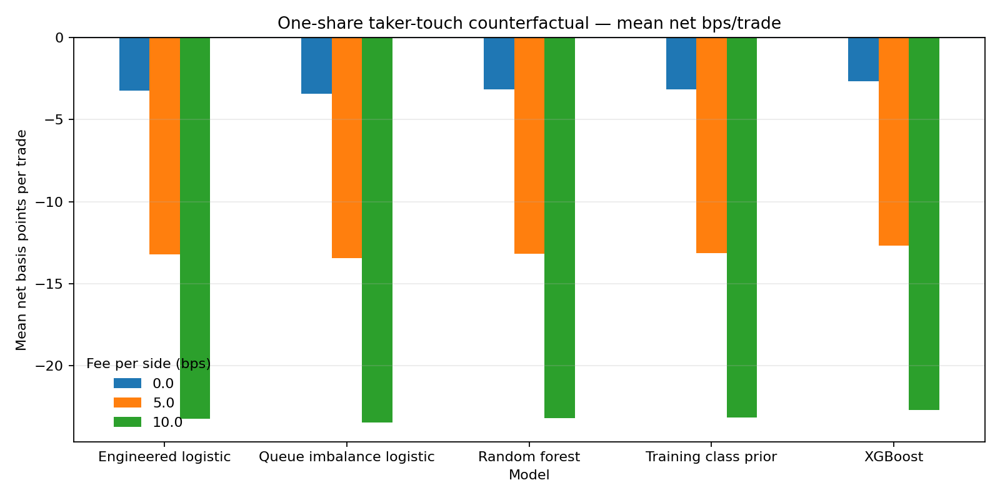
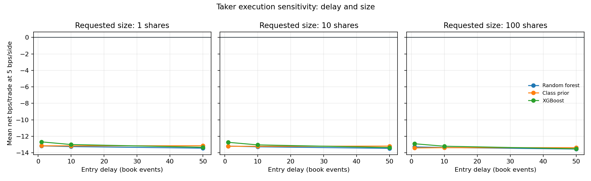
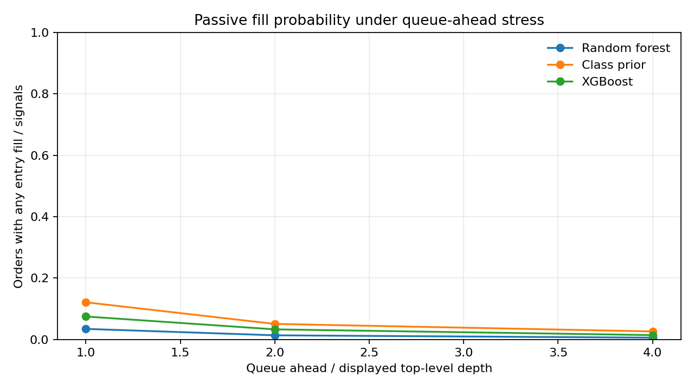

# FUTURE

### Financial Uncertainty Testing Under Regime Evolution

**Can machine learning extract stable predictive information from financial time series as market distributions change?**

FUTURE is a reproducible financial machine-learning study built around that question. It combines a multi-year daily volatility forecast experiment with a short-horizon limit-order-book benchmark. The focus is out-of-sample behavior under chronological change: where models help, where they fail, and how conclusions depend on the metric.

| Study | Data and validation | Headline result |
|---|---|---|
| **Daily volatility (primary)** | Five liquid US-listed ETFs; expanding-window forecasts from 2010–2026 | ML lowers MAE versus historical volatility for four of five assets, but raises RMSE for all five. Gains are modest and vary by asset and year. |
| **Limit-order-book (companion)** | FI-2010; nine anchored test days, 354,825 held-out events | Models beat the class-prior baseline, but the top model changes with aggregation and scores vary across days. |
| **Raw-event engineering demo** | Official LOBSTER message/book samples; five Nasdaq stocks, one session | A C++ feature path and purged chronological classifier run end to end. Five-level execution sensitivities remain negative before fees, showing that label skill alone is not a trading edge. |

## What the results say

**There is predictive information, but this study does not find one reliably superior model across markets and conditions.** In the primary experiment, the best ML model reduces pooled MAE by about 2.9–6.4% for SPY, QQQ, IWM, and GLD. For TLT, the best ML MAE is about 0.2% worse than the historical-volatility baseline. Every ML model has worse pooled RMSE than that baseline on every asset, meaning the average absolute error improves in some markets while large errors remain a weakness. Year-by-year performance also changes, with some negative years.

The FI-2010 companion adds a faster market-microstructure task. Its classifiers substantially beat a training-class-prior baseline, yet random forest leads on pooled macro-F1 while XGBoost leads on the equal-weight mean across test days and on pooled log loss. This benchmark demonstrates learnable structure in its supplied features; its ten-day span cannot establish a durable signal for modern electronic markets.

A separate raw-event demonstration processes LOBSTER message and five-level order-book files for five Nasdaq stocks. Several models improve macro-F1 on this single-session sample, though the gains are not consistent across every model and stock. The expanded five-level execution sensitivity has negative gross results before fees across the tested delays and sizes. This is a useful check against confusing classification scores with tradable returns, not evidence about persistence across days.

### Multi-session raw order-book study

The companion Nasdaq BX ITCH study extends the raw-event work across eight separate sessions and uses a chronological train/validation/final split. It reconstructs AAPL, MSFT, and INTC books from official ITCH messages, samples the top of book every 100 ms, and predicts the three-class mid-price move one second ahead. The final test contains 2.1 million overlapping snapshots over three reserved dates; those rows are not independent statistical observations.

The preselected XGBoost model achieved mean final-period log loss **0.668**, versus **0.798** for a training class-prior forecast, and beat that reference on all three dates. Its mean macro-F1 was **0.348**; the random forest scored higher at **0.399**, illustrating that model rankings depend on the metric. The selected model's log loss rose from 0.541–0.556 on the first two final sessions to 0.907 on March 2, 2020. Its calibration also worsened for AAPL and MSFT that day. This is evidence of useful probabilistic structure in this sample, with visible regime sensitivity—not proof of a stable trading signal.

The order-level passive replay is a separate reality check. Under 1, 10, and 50 ms delays, XGBoost had a **0.143–0.169% entry-fill rate** and a fill-weighted gross marked result of **−39.60 bps per filled order** across those scenarios before fees. At 1 ms, the gross result was −41.07 bps per filled order; 1 and 5 bps per-side fees reduce it to −43.07 and −51.07 bps. The result does not support profitability. It does show why predictive scores need to be tested against queue position, latency, fill scarcity, and costs.

The results and evidence are visible without opening a notebook: [full multi-session report](results/nasdaq_bx_itch/report.md), [final-period model comparison](results/nasdaq_bx_itch/figures/final_test_model_scores.png), [distribution-shift diagnostics](results/nasdaq_bx_itch/figures/final_test_feature_shift.png), [queue and delay sensitivity](results/nasdaq_bx_itch/figures/final_test_queue_stress.png), and [PDF report](output/pdf/nasdaq_bx_multisession_report.pdf). The frozen split, settings, source hashes, and final evaluation hashes are in [the protocol lock](results/nasdaq_bx_itch/protocol_lock.json) and [data provenance record](results/nasdaq_bx_itch/data_provenance.json).

The daily-volatility and FI-2010 sections are forecasting experiments, **not evidence of a profitable strategy**. Only the separate LOBSTER demonstration includes a simplified execution-cost counterfactual, with the limitations described below.

## Primary result: daily volatility forecasting

### Error depends on the metric

The chart shows percentage improvement over historical volatility (positive favors the ML model). The left panel uses MAE; the right uses RMSE. Lower forecast error is better.



Best ML model per asset, selected from the evaluated linear, random-forest, and XGBoost forecasts:

| Asset | Held-out forecasts | Historical-volatility MAE | Best ML model | Best ML MAE | MAE change vs baseline |
|---|---:|---:|---|---:|---:|
| SPY | 4,179 | 0.498% | Random forest | 0.467% | **6.4% lower** |
| QQQ | 4,179 | 0.622% | XGBoost | 0.597% | **4.1% lower** |
| IWM | 4,078 | 0.631% | XGBoost | 0.613% | **2.9% lower** |
| TLT | 3,535 | 0.416% | XGBoost | 0.417% | **0.2% higher** |
| GLD | 2,953 | 0.496% | Random forest | 0.474% | **4.6% lower** |

MAE values are in percent of the next-session absolute close-to-close log return. “Best” is chosen within each asset using the same held-out pooled MAE shown here; it is a summary, not a separately validated model-selection procedure. The table should be read with the RMSE comparison and chronological chart, not in isolation.

### The lead changes across years

The XGBoost line below compares its annual MAE with the historical-volatility baseline for each asset. Positive values favor XGBoost. The sign changes over time, which is central to the distribution-shift question: a pooled improvement does not mean a stable advantage in every year.



### Event probabilities provide a secondary view

A separate logistic model estimates whether the next session's absolute return exceeds the training-window 80th-percentile threshold. Across the five assets, it improves on a training base-rate forecast in log loss, but discrimination and calibration vary by asset. The plot reports ROC-AUC and log loss; it is not a trading signal.



## Companion result: FI-2010 order-book benchmark

This companion uses the official FI-2010 NoAuction Z-score feature matrices and published anchored folds. The task predicts the benchmark's up, stationary, or down label at the ten-event horizon. The experiment tests across nine consecutive held-out days, with fixed hyperparameters and no tuning on test folds.

| Model | Mean test-day macro-F1 (SD) | Pooled macro-F1 | Pooled log loss |
|---|---:|---:|---:|
| Training class prior | 0.186 (0.012) | 0.184 | 1.087 |
| Logistic regression | 0.395 (0.034) | 0.402 | 1.042 |
| Random forest | 0.474 (0.039) | **0.502** | 0.988 |
| XGBoost | **0.478 (0.050)** | 0.496 | **0.959** |

The equal-weight mean scores each day equally; pooled scores weight each event equally. That changes which model ranks first. All three classifiers beat the class-prior reference on these metrics, but the leaderboard is close between the tree models and their per-day scores move. The adjacent forward-horizon labels overlap, so event counts are not independent observations.

To show uncertainty at the day level, the repository also reports paired two-day moving-block bootstrap intervals for each model's mean improvement over the class-prior baseline. Across nine ordered test folds, XGBoost's mean macro-F1 advantage is 0.292 (95% descriptive interval 0.257 to 0.325); its mean log-loss improvement is 0.124 (0.101 to 0.145). The intervals resample days, not events. With only nine chronological folds and expanding overlapping training sets, these are descriptive uncertainty summaries, not independent-sample significance tests or proof of persistence.

The exploratory rank association between feature PSI and log loss is positive but modest (Spearman 0.38–0.43 across the three models); the association with macro-F1 is near zero in this nine-day sample. This does not establish that PSI causes performance changes. The inference outputs are in [`day_block_inference.csv`](results/market_microstructure/day_block_inference.csv) and [`shift_performance_association.csv`](results/market_microstructure/shift_performance_association.csv).

No final untouched test period was reserved after these results were explored. Treat all reported fold results as a completed benchmark study; a future extension should lock its model choices and evaluation protocol before collecting a new test period.



The feature-shift diagnostic shows relatively small median PSI alongside very large 90th-percentile feature PSI in some folds. A small typical shift therefore coexists with substantial shifts in a subset of features.



## Raw-event engineering and execution reality check

FI-2010 is distributed as normalized feature matrices, so it cannot support an order-entry or fill simulation. To exercise a raw message path, the project includes LOBSTER's publicly posted five-level message and order-book samples for AAPL, AMZN, GOOG, INTC, and MSFT on 2012-06-21. The C++17 program validates aligned rows and market state, retains message identifiers and event prices, and emits microstructure features plus all five book levels. It processed about 1.75 million rows at roughly 355,000–427,000 rows per second in this local Windows run. This is buffered file-processing throughput, not exchange latency or production performance.

Each stock uses the first 70% of its session for training and the final 30% for testing. The last 100 training events are purged because the label looks 100 events ahead. Macro-F1 is emphasized because the session's class distribution is strongly imbalanced.

| Stock | Best macro-F1 model on this test slice | Macro-F1 | Training class-prior macro-F1 |
|---|---|---:|---:|
| AAPL | Random forest | 0.389 | 0.219 |
| AMZN | Random forest | 0.392 | 0.216 |
| GOOG | Engineered logistic regression | 0.397 | 0.223 |
| INTC | XGBoost | 0.402 | 0.326 |
| MSFT | XGBoost | 0.504 | 0.322 |

These are descriptive rankings on the reported test slices; they are not a separate model-selection validation.

The cost check uses a fixed prediction rule and prevents overlapping positions. It sweeps the five displayed levels for requested quantities of 1, 10, or 100 shares, delays entry by 1, 10, or 50 events, and applies 0, 5, or 10 basis points of fees per side. Partial fills are tracked; residual inventory at the scheduled exit is marked to mid.

| Model | Test trades | Mean gross bps/trade | Mean net bps/trade at 5 bps/side |
|---|---:|---:|---:|
| XGBoost | 2,244 | -2.68 | -12.68 |
| Random forest | 4,257 | -3.17 | -13.17 |
| Engineered logistic regression | 4,591 | -3.23 | -13.23 |
| Queue-imbalance logistic regression | 4,314 | -3.44 | -13.44 |
| Training class prior | 1,676 | -3.15 | -13.15 |

Every model loses on this simple taker-touch counterfactual before fees. The result is deliberately reported because the stronger classification scores do not translate into positive gross performance here.







The passive queue-ahead proxy shows how quickly fill likelihood falls when assumed queue depth grows. For a 10-share XGBoost order with a one-event delay, 7.5% of signals receive any entry fill at 1x displayed depth ahead; this drops to 1.4% at 4x. At 5 bps per side, the mean marked result remains around -11.3 bps per filled trade. It assumes no maker rebate and ignores cancellations, so it is a stress diagnostic rather than a calibrated fill model.



At 5 bps per side, XGBoost's mean taker net result moves from -12.68 bps/trade at a one-event delay and one-share size to -13.33 bps at 50 events; for 100 shares at 50 events it is -13.52 bps with about 99.6% of requested entry size filled on average.

The report also includes a separate passive-order queue-ahead proxy. It joins the displayed best price, assumes 1x, 2x, or 4x displayed size ahead, and counts visible executions at that price toward a fill; cancellations do not improve its assumed queue position. It reports fill probability and a five-level taker exit. This is an aggregate queue stress model, not exact FIFO/order-ID replay. Both execution scenarios use event-count delays, not measured wall-clock or exchange latency, omit impact beyond five displayed levels and participant-specific fees, and cover only one day. Raw sample files are not committed. See the [official sample source](https://php.lobsterdata.com/info/DataSamples.php), [access options](https://php.lobsterdata.com/info/AccessOptions.php), and [terms](https://php.lobsterdata.com/termsAndConditions.php).

Run the raw-event demonstration after installing the microstructure extras and a C++17 compiler:

```powershell
python -m src.run_lobster_sample
```

It verifies the official sample ZIP hashes and writes aggregate results, metadata, and figures to [`results/market_microstructure/lobster_sample/`](results/market_microstructure/lobster_sample/). The sample archives and extracted files remain under git-ignored `data/`.

## How the study was run

### Daily volatility experiment

- **Universe and period:** SPY, QQQ, IWM, TLT, and GLD; adjusted daily Yahoo Finance data from 2000 through the latest retrieved session, 2026-11-19. Forecast evaluation begins after the initial training period and available history; first forecast dates differ by asset.
- **Target:** next-session absolute close-to-close log return, a noisy daily volatility proxy. Models are trained on next-session log squared return and transformed back to volatility units. Intraday realized volatility is not available in the free daily data.
- **Inputs:** current and lagged returns, rolling volatility and mean absolute return over 5, 10, 21, and 63 sessions, volume change, and a missing-volume indicator. Features use information available at the forecast origin.
- **Models:** 21-session historical volatility, linear regression, random forest, and XGBoost. Logistic regression is used separately for high-volatility event probabilities. LSTM and attention models were excluded because the daily sample is small and tabular baselines answer the main question with fewer tuning degrees of freedom.
- **Validation:** 2,520-session initial training window, then non-overlapping 252-session test blocks in an expanding chronological walk-forward. No random shuffle. A SPY sensitivity run uses six-month test blocks.
- **Metrics and inference:** pooled and year/fold MAE and RMSE, regime slices, and event log loss, Brier score, ROC-AUC, average precision, and calibration error. Paired absolute-error tests use a 21-session Newey-West/HAC standard error; Holm adjustment covers the 15 asset/model comparisons. Adjusted results are mixed and are described in the full report.

### FI-2010 order-book experiment

- **Data:** official FI-2010 benchmark, five Nasdaq Nordic stocks pooled in the released matrices, ten consecutive trading days in June 2010, 144 supplied features, and the ten-event-ahead three-class mid-price label.
- **Validation:** published anchored folds CF_1–CF_9. Each fold trains on its past window and tests on the next day. Hyperparameters were fixed before test-fold evaluation.
- **Models and metrics:** training class-prior reference, logistic regression, random forest, and XGBoost; macro-F1, balanced accuracy, log loss, multiclass Brier score, and feature population-stability diagnostics. Out-of-sample event predictions are retained for audit.

## Reproduce the results

Python 3.11–3.13 is supported by the project CI workflow. From a fresh checkout:

```powershell
python -m venv .venv
.venv\Scripts\Activate.ps1
pip install -e ".[download,notebooks,test,microstructure]"
pytest -q
python -m src.run_experiment --start 2000-01-01 --min-train-size 2520 --test-size 252
python -m src.generate_report
```

Daily market prices are fetched from Yahoo Finance through `yfinance` and are not committed. Provider terms govern access and redistribution. Local run metadata records retrieval date, package versions, and per-asset data checksums. To run a smaller universe, use `--tickers SPY,QQQ`; to use a local price CSV, pass `--input-csv`, `--date-column`, and `--price-column`.

The FI-2010 download and experiment are separate:

```powershell
python -m src.download_fi2010
python -m src.market_microstructure
python -m src.microstructure_inference
python -m src.generate_microstructure_report
```

The download checks the source package and inner ZIP against published SHA-256 checksums. Raw daily prices and FI-2010 matrices stay outside Git; derived results, metadata, figures, and compressed held-out predictions are versioned.

The multi-session Nasdaq BX study has its own end-to-end reproduction commands and caveats in [its report](results/nasdaq_bx_itch/report.md) and [frozen protocol](docs/nasdaq_bx_protocol.md). The raw exchange archives and reconstructed order-event logs are not committed; download them only under Nasdaq's applicable terms. Its final holdout is intentionally a one-run evaluation.

## Browse the repository

| Path | Contents |
|---|---|
| [`src/`](src/) | Data preparation, features, models, walk-forward evaluation, and report generation |
| [`src/microstructure_inference.py`](src/microstructure_inference.py) | Paired day-block bootstrap intervals and descriptive PSI/performance associations for FI-2010 |
| [`tests/`](tests/) | Focused checks for preprocessing, targets, and chronological splits |
| [`notebooks/`](notebooks/) | Exploration, feature engineering, and model evaluation notebooks |
| [`results/`](results/) | Committed forecast tables, fold/year/regime metrics, figures, predictions, and run metadata |
| [`results/market_microstructure/`](results/market_microstructure/) | FI-2010 fold scores, uncertainty analysis, shift diagnostics, predictions, and companion report |
| [`results/market_microstructure/lobster_sample/`](results/market_microstructure/lobster_sample/) | Per-stock metrics, taker and passive queue sensitivities, metadata, and charts |
| [`results/market_microstructure/report.pdf`](results/market_microstructure/report.pdf) | FI-2010 companion report with day-block uncertainty analysis |
| [`results/nasdaq_bx_itch/report.md`](results/nasdaq_bx_itch/report.md) | Multi-session raw ITCH findings, per-date scores, calibration, shift, queue replay, and limits |
| [`output/pdf/nasdaq_bx_multisession_report.pdf`](output/pdf/nasdaq_bx_multisession_report.pdf) | Three-part report on model scores, distribution shift, and queue-aware execution |
| [`docs/nasdaq_bx_protocol.md`](docs/nasdaq_bx_protocol.md) | Data schema, session split, reconstruction protocol, and limits |
| [`src/nasdaq_itch_study.py`](src/nasdaq_itch_study.py) and [`src/nasdaq_queue_simulation.py`](src/nasdaq_queue_simulation.py) | ITCH parsing pipeline, frozen evaluation, and public-order-ID queue replay |
| [`src/lobster_features.cpp`](src/lobster_features.cpp) | C++17 feature extraction from aligned LOBSTER event and book samples |
| [`research_report.pdf`](research_report.pdf) | Full daily volatility research report |
| [`output/pdf/future_market_ml_research.pdf`](output/pdf/future_market_ml_research.pdf) | Combined report with the FI-2010 companion |

## Limitations and interpretation

- Five ETF proxies and one vendor do not represent all markets. This is not a production feed or a current-market guarantee.
- The daily target is noisy, and adjusted close data cannot reveal intraday or execution-level behavior. Asset histories differ.
- Gains are modest, metric-dependent, and not consistent in every year. The analysis does not show that the learned signal is durable or that an ML model dominates the volatility baseline.
- FI-2010 covers only ten trading days from 2010. The released matrices used here do not identify each row's stock, and overlapping labels make event-level results dependent. Its normalized features and benchmark design limit claims beyond this dataset.
- The daily-volatility and FI-2010 experiments do not simulate executable trades. The LOBSTER taker sweep and passive queue-ahead proxy are one-day counterfactuals; the latter is not exact FIFO replay. Neither measures real latency or participant-specific fees, models impact beyond the visible depth, or establishes profitability.
- The expanded Nasdaq BX study uses eight nonconsecutive sample sessions from 2019–2020, three stocks, and one venue. Only three dates are held out; per-date performance and PSI are descriptive, with no claim of statistical significance or persistence across modern market regimes. Its order-ID replay models queue ahead from public messages, but omits hidden liquidity, exchange acknowledgement/clock behavior, market impact, and participant-specific fee/rebate schedules.
- Results depend on the frozen data snapshots and specified hyperparameters. Re-fetching vendor data later may change prices and metrics.

## Data and code licenses

Project code is licensed under the [MIT License](LICENSE). FI-2010 is separately licensed **CC BY 4.0**; the benchmark's attribution is recorded in its report and run metadata. Yahoo Finance data is not redistributed, and its provider terms apply. See the dataset record at [Fairdata Etsin](https://etsin.fairdata.fi/dataset/73eb48d7-4dbc-4a10-a52a-da745b47a649).

## References

- Qiu, Z., Kownatzki, C., Scalzo, F., and Cha, E.S. (2025). “Historical Perspectives in Volatility Forecasting Methods with Machine Learning.” *Risks*, 13(5), 98. [DOI](https://doi.org/10.3390/risks13050098).
- Ntakaris, A., Magris, M., Kanniainen, J., Gabbouj, M., and Iosifidis, A. (2018). “Benchmark dataset for mid-price forecasting of limit order book data with machine learning methods.” *Journal of Forecasting*, 37(8), 852–866. [DOI](https://doi.org/10.1002/for.2543); [arXiv](https://arxiv.org/abs/1705.03233).
- HRT, [Generalization in low signal-to-noise machine-learning benchmarks](https://www.hudsonrivertrading.com/hrtbeat/trading-machine-learning/).
