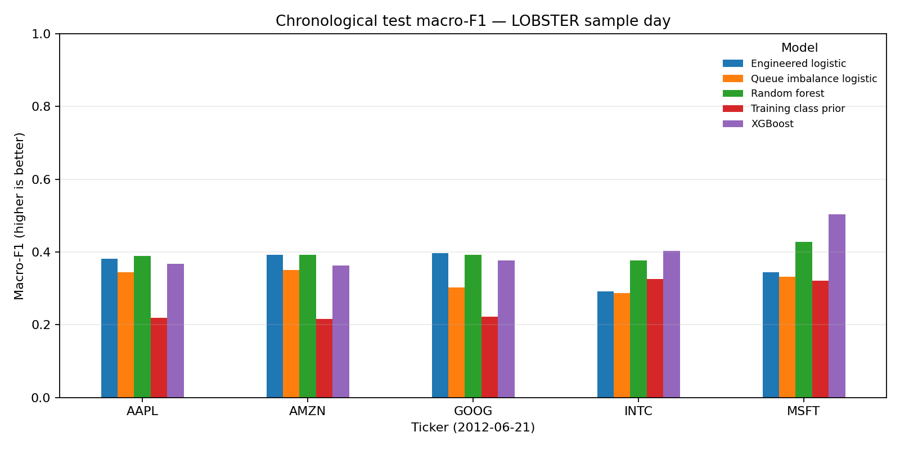
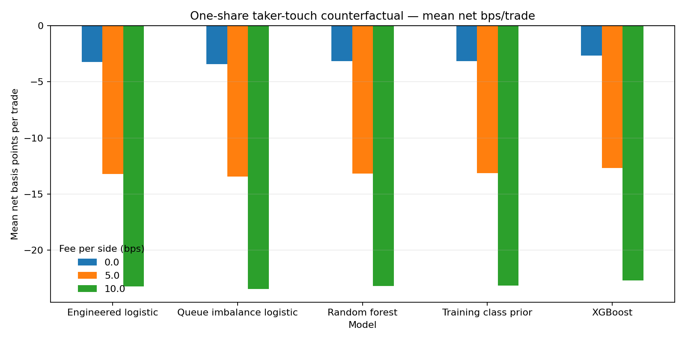
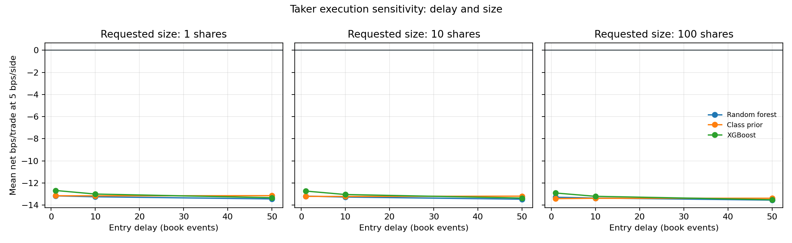
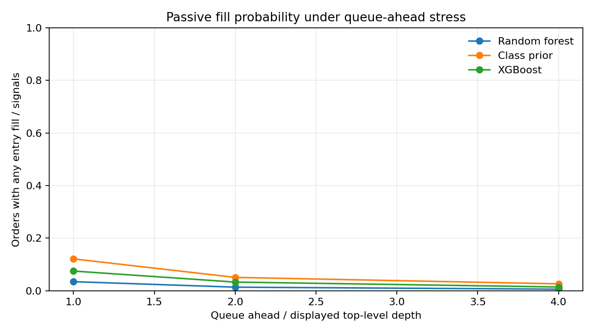

# LOBSTER raw-event sample study

## Scope

This engineering and modeling demonstration uses LOBSTER's public five-level sample files for five US stocks on 2012-06-21. It is one session, so it cannot establish persistence across days or regimes.

The C++17 extractor processed 1,747,025 aligned message/book events in total. It derives top-of-book spread, queue imbalance, order-flow imbalance, and signed event flow. Raw sample archives are kept outside Git; their SHA-256 hashes are in `run_metadata.json`.

## Evaluation

The target is the mid-price direction 100 book events ahead; moves within half a cent are labeled stationary. Each ticker uses a chronological 70/30 split. The last 100 training events are purged so training labels cannot extend into the test period.

| Ticker | Model | Train events | Test events | Macro-F1 | Balanced accuracy | Log loss |
|---|---|---:|---:|---:|---:|---:|
| AAPL | engineered_logistic | 211,010 | 90,377 | 0.382 | 0.385 | 1.077 |
| AAPL | queue_imbalance_logistic | 211,010 | 90,377 | 0.345 | 0.346 | 1.096 |
| AAPL | random_forest | 211,010 | 90,377 | 0.389 | 0.389 | 1.033 |
| AAPL | training_class_prior | 211,010 | 90,377 | 0.219 | 0.333 | 0.927 |
| AAPL | xgboost | 211,010 | 90,377 | 0.368 | 0.385 | 0.912 |
| AMZN | engineered_logistic | 109,054 | 46,681 | 0.392 | 0.406 | 1.094 |
| AMZN | queue_imbalance_logistic | 109,054 | 46,681 | 0.351 | 0.377 | 1.094 |
| AMZN | random_forest | 109,054 | 46,681 | 0.392 | 0.395 | 1.041 |
| AMZN | training_class_prior | 109,054 | 46,681 | 0.216 | 0.333 | 0.939 |
| AMZN | xgboost | 109,054 | 46,681 | 0.363 | 0.382 | 0.922 |
| GOOG | engineered_logistic | 78,771 | 33,702 | 0.397 | 0.397 | 1.027 |
| GOOG | queue_imbalance_logistic | 78,771 | 33,702 | 0.302 | 0.363 | 1.088 |
| GOOG | random_forest | 78,771 | 33,702 | 0.391 | 0.395 | 0.933 |
| GOOG | training_class_prior | 78,771 | 33,702 | 0.223 | 0.333 | 0.844 |
| GOOG | xgboost | 78,771 | 33,702 | 0.376 | 0.388 | 0.818 |
| INTC | engineered_logistic | 406,621 | 174,209 | 0.292 | 0.768 | 0.970 |
| INTC | queue_imbalance_logistic | 406,621 | 174,209 | 0.287 | 0.754 | 0.945 |
| INTC | random_forest | 406,621 | 174,209 | 0.377 | 0.781 | 0.759 |
| INTC | training_class_prior | 406,621 | 174,209 | 0.326 | 0.333 | 0.224 |
| INTC | xgboost | 406,621 | 174,209 | 0.402 | 0.381 | 0.173 |
| MSFT | engineered_logistic | 416,960 | 178,640 | 0.344 | 0.760 | 0.927 |
| MSFT | queue_imbalance_logistic | 416,960 | 178,640 | 0.332 | 0.726 | 0.933 |
| MSFT | random_forest | 416,960 | 178,640 | 0.427 | 0.771 | 0.738 |
| MSFT | training_class_prior | 416,960 | 178,640 | 0.322 | 0.333 | 0.311 |
| MSFT | xgboost | 416,960 | 178,640 | 0.504 | 0.462 | 0.224 |



## Taker-touch execution sensitivity

Predicted directional classes are entered after 1, 10, or 50 events and exited 100 events later. Orders request 1, 10, or 100 shares and sweep the displayed five-level book; partial entry/exit fills and residual inventory marked to mid are tracked. Fees are scenario assumptions per side.

This is a counterfactual benchmark, not a full simulator: delays are event counts rather than elapsed time; market impact beyond five displayed levels and participant-specific fees are not modeled. Residual inventory is marked to mid rather than assumed filled. It must not be read as a profitable strategy result.

| Model | Delay (events) | Requested shares | Fee per side (bps) | Trades | Entry fill ratio | Exit fill ratio | Mean net bps/trade |
|---|---:|---:|---:|---:|---:|---:|---:|
| engineered_logistic | 1 | 1 | 0.0 | 4,591 | 1.000 | 1.000 | -3.227 |
| engineered_logistic | 1 | 10 | 0.0 | 4,591 | 1.000 | 1.000 | -3.254 |
| engineered_logistic | 1 | 100 | 0.0 | 4,591 | 0.998 | 0.999 | -3.349 |
| engineered_logistic | 10 | 1 | 0.0 | 4,241 | 1.000 | 1.000 | -3.298 |
| engineered_logistic | 10 | 10 | 0.0 | 4,241 | 1.000 | 1.000 | -3.320 |
| engineered_logistic | 10 | 100 | 0.0 | 4,241 | 0.997 | 0.999 | -3.408 |
| engineered_logistic | 50 | 1 | 0.0 | 3,170 | 1.000 | 1.000 | -3.449 |
| engineered_logistic | 50 | 10 | 0.0 | 3,170 | 1.000 | 1.000 | -3.472 |
| engineered_logistic | 50 | 100 | 0.0 | 3,170 | 0.998 | 0.999 | -3.546 |
| engineered_logistic | 1 | 1 | 5.0 | 4,591 | 1.000 | 1.000 | -13.227 |
| engineered_logistic | 1 | 10 | 5.0 | 4,591 | 1.000 | 1.000 | -13.254 |
| engineered_logistic | 1 | 100 | 5.0 | 4,591 | 0.998 | 0.999 | -13.346 |
| engineered_logistic | 10 | 1 | 5.0 | 4,241 | 1.000 | 1.000 | -13.298 |
| engineered_logistic | 10 | 10 | 5.0 | 4,241 | 1.000 | 1.000 | -13.320 |
| engineered_logistic | 10 | 100 | 5.0 | 4,241 | 0.997 | 0.999 | -13.404 |
| engineered_logistic | 50 | 1 | 5.0 | 3,170 | 1.000 | 1.000 | -13.449 |
| engineered_logistic | 50 | 10 | 5.0 | 3,170 | 1.000 | 1.000 | -13.472 |
| engineered_logistic | 50 | 100 | 5.0 | 3,170 | 0.998 | 0.999 | -13.544 |
| engineered_logistic | 1 | 1 | 10.0 | 4,591 | 1.000 | 1.000 | -23.227 |
| engineered_logistic | 1 | 10 | 10.0 | 4,591 | 1.000 | 1.000 | -23.254 |
| engineered_logistic | 1 | 100 | 10.0 | 4,591 | 0.998 | 0.999 | -23.342 |
| engineered_logistic | 10 | 1 | 10.0 | 4,241 | 1.000 | 1.000 | -23.298 |
| engineered_logistic | 10 | 10 | 10.0 | 4,241 | 1.000 | 1.000 | -23.320 |
| engineered_logistic | 10 | 100 | 10.0 | 4,241 | 0.997 | 0.999 | -23.401 |
| engineered_logistic | 50 | 1 | 10.0 | 3,170 | 1.000 | 1.000 | -23.449 |
| engineered_logistic | 50 | 10 | 10.0 | 3,170 | 1.000 | 1.000 | -23.472 |
| engineered_logistic | 50 | 100 | 10.0 | 3,170 | 0.998 | 0.999 | -23.541 |
| queue_imbalance_logistic | 1 | 1 | 0.0 | 4,314 | 1.000 | 1.000 | -3.443 |
| queue_imbalance_logistic | 1 | 10 | 0.0 | 4,314 | 1.000 | 1.000 | -3.473 |
| queue_imbalance_logistic | 1 | 100 | 0.0 | 4,314 | 0.998 | 0.998 | -3.581 |
| queue_imbalance_logistic | 10 | 1 | 0.0 | 3,985 | 1.000 | 1.000 | -3.424 |
| queue_imbalance_logistic | 10 | 10 | 0.0 | 3,985 | 1.000 | 1.000 | -3.450 |
| queue_imbalance_logistic | 10 | 100 | 0.0 | 3,985 | 0.997 | 0.998 | -3.545 |
| queue_imbalance_logistic | 50 | 1 | 0.0 | 3,028 | 1.000 | 1.000 | -3.537 |
| queue_imbalance_logistic | 50 | 10 | 0.0 | 3,028 | 1.000 | 1.000 | -3.561 |
| queue_imbalance_logistic | 50 | 100 | 0.0 | 3,028 | 0.997 | 0.998 | -3.640 |
| queue_imbalance_logistic | 1 | 1 | 5.0 | 4,314 | 1.000 | 1.000 | -13.443 |
| queue_imbalance_logistic | 1 | 10 | 5.0 | 4,314 | 1.000 | 1.000 | -13.473 |
| queue_imbalance_logistic | 1 | 100 | 5.0 | 4,314 | 0.998 | 0.998 | -13.574 |
| queue_imbalance_logistic | 10 | 1 | 5.0 | 3,985 | 1.000 | 1.000 | -13.424 |
| queue_imbalance_logistic | 10 | 10 | 5.0 | 3,985 | 1.000 | 1.000 | -13.450 |
| queue_imbalance_logistic | 10 | 100 | 5.0 | 3,985 | 0.997 | 0.998 | -13.541 |
| queue_imbalance_logistic | 50 | 1 | 5.0 | 3,028 | 1.000 | 1.000 | -13.537 |
| queue_imbalance_logistic | 50 | 10 | 5.0 | 3,028 | 1.000 | 1.000 | -13.561 |
| queue_imbalance_logistic | 50 | 100 | 5.0 | 3,028 | 0.997 | 0.998 | -13.635 |
| queue_imbalance_logistic | 1 | 1 | 10.0 | 4,314 | 1.000 | 1.000 | -23.443 |
| queue_imbalance_logistic | 1 | 10 | 10.0 | 4,314 | 1.000 | 1.000 | -23.473 |
| queue_imbalance_logistic | 1 | 100 | 10.0 | 4,314 | 0.998 | 0.998 | -23.567 |
| queue_imbalance_logistic | 10 | 1 | 10.0 | 3,985 | 1.000 | 1.000 | -23.424 |
| queue_imbalance_logistic | 10 | 10 | 10.0 | 3,985 | 1.000 | 1.000 | -23.450 |
| queue_imbalance_logistic | 10 | 100 | 10.0 | 3,985 | 0.997 | 0.998 | -23.538 |
| queue_imbalance_logistic | 50 | 1 | 10.0 | 3,028 | 1.000 | 1.000 | -23.537 |
| queue_imbalance_logistic | 50 | 10 | 10.0 | 3,028 | 1.000 | 1.000 | -23.561 |
| queue_imbalance_logistic | 50 | 100 | 10.0 | 3,028 | 0.997 | 0.998 | -23.630 |
| random_forest | 1 | 1 | 0.0 | 4,257 | 1.000 | 1.000 | -3.166 |
| random_forest | 1 | 10 | 0.0 | 4,257 | 1.000 | 1.000 | -3.190 |
| random_forest | 1 | 100 | 0.0 | 4,257 | 0.998 | 0.999 | -3.296 |
| random_forest | 10 | 1 | 0.0 | 3,940 | 1.000 | 1.000 | -3.251 |
| random_forest | 10 | 10 | 0.0 | 3,940 | 1.000 | 1.000 | -3.276 |
| random_forest | 10 | 100 | 0.0 | 3,940 | 0.998 | 0.999 | -3.369 |
| random_forest | 50 | 1 | 0.0 | 2,980 | 1.000 | 1.000 | -3.444 |
| random_forest | 50 | 10 | 0.0 | 2,980 | 1.000 | 1.000 | -3.467 |
| random_forest | 50 | 100 | 0.0 | 2,980 | 0.998 | 0.999 | -3.554 |
| random_forest | 1 | 1 | 5.0 | 4,257 | 1.000 | 1.000 | -13.166 |
| random_forest | 1 | 10 | 5.0 | 4,257 | 1.000 | 1.000 | -13.190 |
| random_forest | 1 | 100 | 5.0 | 4,257 | 0.998 | 0.999 | -13.291 |
| random_forest | 10 | 1 | 5.0 | 3,940 | 1.000 | 1.000 | -13.251 |
| random_forest | 10 | 10 | 5.0 | 3,940 | 1.000 | 1.000 | -13.276 |
| random_forest | 10 | 100 | 5.0 | 3,940 | 0.998 | 0.999 | -13.365 |
| random_forest | 50 | 1 | 5.0 | 2,980 | 1.000 | 1.000 | -13.444 |
| random_forest | 50 | 10 | 5.0 | 2,980 | 1.000 | 1.000 | -13.467 |
| random_forest | 50 | 100 | 5.0 | 2,980 | 0.998 | 0.999 | -13.550 |
| random_forest | 1 | 1 | 10.0 | 4,257 | 1.000 | 1.000 | -23.166 |
| random_forest | 1 | 10 | 10.0 | 4,257 | 1.000 | 1.000 | -23.190 |
| random_forest | 1 | 100 | 10.0 | 4,257 | 0.998 | 0.999 | -23.286 |
| random_forest | 10 | 1 | 10.0 | 3,940 | 1.000 | 1.000 | -23.251 |
| random_forest | 10 | 10 | 10.0 | 3,940 | 1.000 | 1.000 | -23.276 |
| random_forest | 10 | 100 | 10.0 | 3,940 | 0.998 | 0.999 | -23.361 |
| random_forest | 50 | 1 | 10.0 | 2,980 | 1.000 | 1.000 | -23.444 |
| random_forest | 50 | 10 | 10.0 | 2,980 | 1.000 | 1.000 | -23.467 |
| random_forest | 50 | 100 | 10.0 | 2,980 | 0.998 | 0.999 | -23.546 |
| training_class_prior | 1 | 1 | 0.0 | 1,676 | 1.000 | 1.000 | -3.154 |
| training_class_prior | 1 | 10 | 0.0 | 1,676 | 1.000 | 1.000 | -3.212 |
| training_class_prior | 1 | 100 | 0.0 | 1,676 | 1.000 | 0.995 | -3.438 |
| training_class_prior | 10 | 1 | 0.0 | 1,540 | 1.000 | 1.000 | -3.164 |
| training_class_prior | 10 | 10 | 0.0 | 1,540 | 1.000 | 1.000 | -3.221 |
| training_class_prior | 10 | 100 | 0.0 | 1,540 | 1.000 | 0.992 | -3.413 |
| training_class_prior | 50 | 1 | 0.0 | 1,131 | 1.000 | 1.000 | -3.148 |
| training_class_prior | 50 | 10 | 0.0 | 1,131 | 1.000 | 1.000 | -3.192 |
| training_class_prior | 50 | 100 | 0.0 | 1,131 | 1.000 | 0.996 | -3.398 |
| training_class_prior | 1 | 1 | 5.0 | 1,676 | 1.000 | 1.000 | -13.154 |
| training_class_prior | 1 | 10 | 5.0 | 1,676 | 1.000 | 1.000 | -13.212 |
| training_class_prior | 1 | 100 | 5.0 | 1,676 | 1.000 | 0.995 | -13.416 |
| training_class_prior | 10 | 1 | 5.0 | 1,540 | 1.000 | 1.000 | -13.164 |
| training_class_prior | 10 | 10 | 5.0 | 1,540 | 1.000 | 1.000 | -13.221 |
| training_class_prior | 10 | 100 | 5.0 | 1,540 | 1.000 | 0.992 | -13.385 |
| training_class_prior | 50 | 1 | 5.0 | 1,131 | 1.000 | 1.000 | -13.148 |
| training_class_prior | 50 | 10 | 5.0 | 1,131 | 1.000 | 1.000 | -13.192 |
| training_class_prior | 50 | 100 | 5.0 | 1,131 | 1.000 | 0.996 | -13.381 |
| training_class_prior | 1 | 1 | 10.0 | 1,676 | 1.000 | 1.000 | -23.154 |
| training_class_prior | 1 | 10 | 10.0 | 1,676 | 1.000 | 1.000 | -23.212 |
| training_class_prior | 1 | 100 | 10.0 | 1,676 | 1.000 | 0.995 | -23.394 |
| training_class_prior | 10 | 1 | 10.0 | 1,540 | 1.000 | 1.000 | -23.164 |
| training_class_prior | 10 | 10 | 10.0 | 1,540 | 1.000 | 1.000 | -23.221 |
| training_class_prior | 10 | 100 | 10.0 | 1,540 | 1.000 | 0.992 | -23.357 |
| training_class_prior | 50 | 1 | 10.0 | 1,131 | 1.000 | 1.000 | -23.148 |
| training_class_prior | 50 | 10 | 10.0 | 1,131 | 1.000 | 1.000 | -23.192 |
| training_class_prior | 50 | 100 | 10.0 | 1,131 | 1.000 | 0.996 | -23.364 |
| xgboost | 1 | 1 | 0.0 | 2,244 | 1.000 | 1.000 | -2.680 |
| xgboost | 1 | 10 | 0.0 | 2,244 | 1.000 | 1.000 | -2.733 |
| xgboost | 1 | 100 | 0.0 | 2,244 | 0.999 | 0.997 | -2.922 |
| xgboost | 10 | 1 | 0.0 | 2,098 | 1.000 | 1.000 | -3.003 |
| xgboost | 10 | 10 | 0.0 | 2,098 | 1.000 | 1.000 | -3.046 |
| xgboost | 10 | 100 | 0.0 | 2,098 | 0.997 | 0.996 | -3.224 |
| xgboost | 50 | 1 | 0.0 | 1,638 | 1.000 | 1.000 | -3.334 |
| xgboost | 50 | 10 | 0.0 | 1,638 | 1.000 | 1.000 | -3.364 |
| xgboost | 50 | 100 | 0.0 | 1,638 | 0.996 | 0.999 | -3.521 |
| xgboost | 1 | 1 | 5.0 | 2,244 | 1.000 | 1.000 | -12.680 |
| xgboost | 1 | 10 | 5.0 | 2,244 | 1.000 | 1.000 | -12.733 |
| xgboost | 1 | 100 | 5.0 | 2,244 | 0.999 | 0.997 | -12.910 |
| xgboost | 10 | 1 | 5.0 | 2,098 | 1.000 | 1.000 | -13.003 |
| xgboost | 10 | 10 | 5.0 | 2,098 | 1.000 | 1.000 | -13.046 |
| xgboost | 10 | 100 | 5.0 | 2,098 | 0.997 | 0.996 | -13.207 |
| xgboost | 50 | 1 | 5.0 | 1,638 | 1.000 | 1.000 | -13.334 |
| xgboost | 50 | 10 | 5.0 | 1,638 | 1.000 | 1.000 | -13.364 |
| xgboost | 50 | 100 | 5.0 | 1,638 | 0.996 | 0.999 | -13.517 |
| xgboost | 1 | 1 | 10.0 | 2,244 | 1.000 | 1.000 | -22.680 |
| xgboost | 1 | 10 | 10.0 | 2,244 | 1.000 | 1.000 | -22.733 |
| xgboost | 1 | 100 | 10.0 | 2,244 | 0.999 | 0.997 | -22.898 |
| xgboost | 10 | 1 | 10.0 | 2,098 | 1.000 | 1.000 | -23.003 |
| xgboost | 10 | 10 | 10.0 | 2,098 | 1.000 | 1.000 | -23.046 |
| xgboost | 10 | 100 | 10.0 | 2,098 | 0.997 | 0.996 | -23.191 |
| xgboost | 50 | 1 | 10.0 | 1,638 | 1.000 | 1.000 | -23.334 |
| xgboost | 50 | 10 | 10.0 | 1,638 | 1.000 | 1.000 | -23.364 |
| xgboost | 50 | 100 | 10.0 | 1,638 | 0.996 | 0.999 | -23.512 |





## Passive queue-ahead proxy

The separate maker-side stress joins the displayed best bid for predicted up moves and best ask for down moves. Queue ahead starts at displayed top-level depth multiplied by 1x, 2x, or 4x. Only visible executions at that exact price and side consume the queue; cancellations are ignored. This is an aggregate queue-ahead proxy, not exact FIFO/order-ID replay. Orders are canceled after the 100-event horizon; filled shares are exited with a five-level sweep and residual shares are marked to mid.

| Model | Delay (events) | Queue multiplier | Signals | Entry fill probability | Unconditional size fill | Mean net bps/trade at 5 bps/side |
|---|---:|---:|---:|---:|---:|---:|
| training_class_prior | 1 | 1x | 1,676 | 0.121 | 0.115 | -11.134 |
| training_class_prior | 1 | 2x | 1,676 | 0.051 | 0.049 | -11.120 |
| training_class_prior | 1 | 4x | 1,676 | 0.026 | 0.025 | -11.260 |
| training_class_prior | 10 | 1x | 1,540 | 0.111 | 0.106 | -11.083 |
| training_class_prior | 10 | 2x | 1,540 | 0.046 | 0.044 | -11.118 |
| training_class_prior | 10 | 4x | 1,540 | 0.024 | 0.023 | -11.095 |
| training_class_prior | 50 | 1x | 1,131 | 0.113 | 0.107 | -11.155 |
| training_class_prior | 50 | 2x | 1,131 | 0.045 | 0.043 | -10.914 |
| training_class_prior | 50 | 4x | 1,131 | 0.027 | 0.026 | -10.956 |
| xgboost | 1 | 1x | 2,244 | 0.075 | 0.072 | -11.263 |
| xgboost | 1 | 2x | 2,244 | 0.033 | 0.032 | -11.144 |
| xgboost | 1 | 4x | 2,244 | 0.014 | 0.013 | -11.258 |
| xgboost | 10 | 1x | 2,098 | 0.078 | 0.076 | -11.245 |
| xgboost | 10 | 2x | 2,098 | 0.029 | 0.028 | -11.264 |
| xgboost | 10 | 4x | 2,098 | 0.014 | 0.013 | -10.938 |
| xgboost | 50 | 1x | 1,638 | 0.074 | 0.072 | -11.195 |
| xgboost | 50 | 2x | 1,638 | 0.035 | 0.034 | -10.944 |
| xgboost | 50 | 4x | 1,638 | 0.018 | 0.018 | -11.110 |



## Reproduction

```powershell
pip install -e ".[microstructure]"
python -m src.run_lobster_sample
```

The runner downloads the official sample ZIPs, verifies SHA-256, compiles the C++ feature extractor, and writes metrics and figures under `results/market_microstructure/lobster_sample/`.

## Source and data handling

- LOBSTER public sample files: [official sample page](https://php.lobsterdata.com/info/DataSamples.php).
- LOBSTER access and terms: [access options](https://php.lobsterdata.com/info/AccessOptions.php) and [terms](https://php.lobsterdata.com/termsAndConditions.php).
- The raw sample files are not committed or redistributed. Check the source terms before using the data outside this demonstration.
