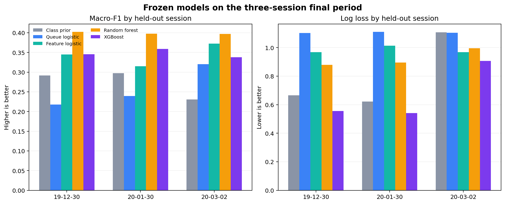
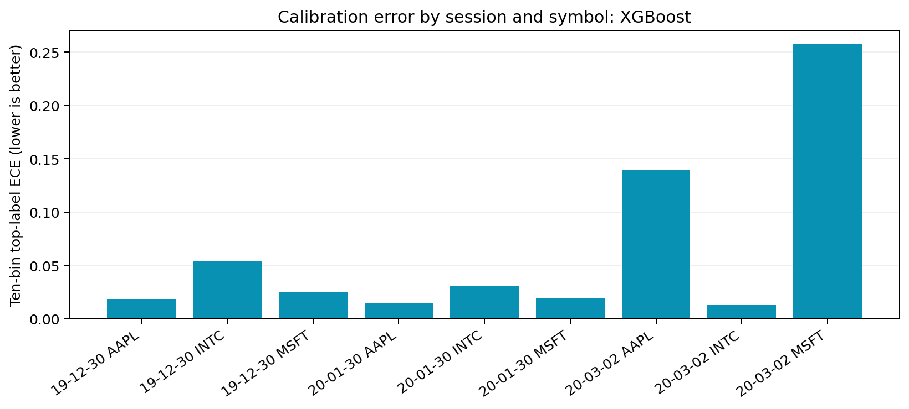
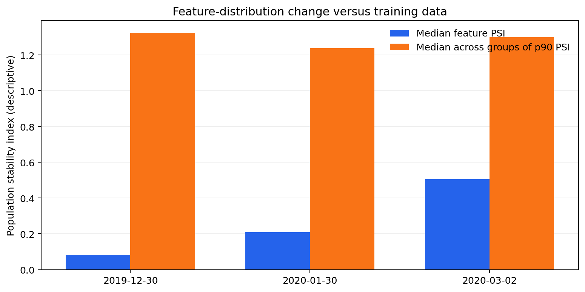
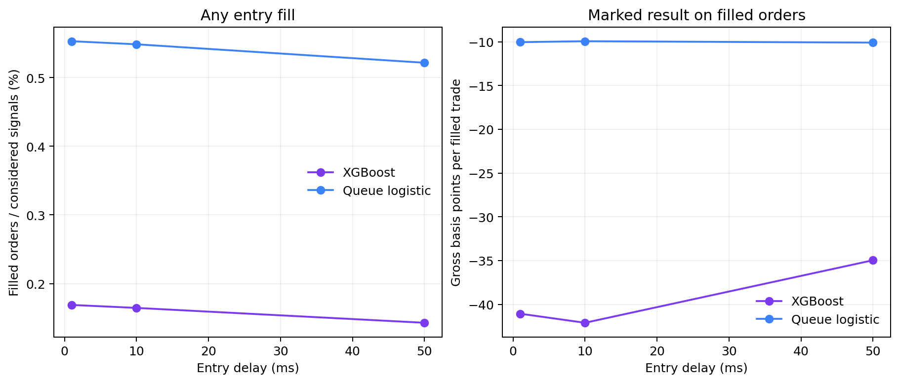

# Multi-session Nasdaq BX order-book study

## Research question

Do short-horizon limit-order-book features provide repeatable predictive information across separate market sessions, and does that information survive a queue-aware execution stress?

## Executive result

The model was selected before the final period: **XGBoost** had the lowest validation log loss on the two validation sessions. On the three predeclared final sessions (2019-12-30, 2020-01-30, 2020-03-02), it had lower average log loss than the training class-prior reference on **3 of 3 dates**. Its average macro-F1 was 0.348, versus 0.273 for the class prior. The result supports measurable short-horizon probabilistic structure in these samples; it does not establish a persistent market signal or trading profitability.

The passive replay produced **110 filled 10-share orders from 69,287 considered signals (0.159%)** for the selected model at zero fees, across the specified delay scenarios. The fill-weighted gross marked result was -39.60 bps per filled order. This counterfactual is conditional on the observed fills and is not an estimate of deployable strategy performance.

## Data and frozen protocol

- Venue/source: official Nasdaq BX TotalView-ITCH 5.0 public sample archives. BX is a Nasdaq venue and this is not a consolidated US market feed.
- Instruments: AAPL, MSFT, and INTC. Training sessions: 2019-01-30, 2019-05-30, 2019-07-30. Validation: 2019-08-30 and 2019-10-30. Final test: 2019-12-30, 2020-01-30, and 2020-03-02.
- The book is sampled every 100 ms; the target is the three-class mid-price move one second later, with moves within one cent labeled flat. Rolling features and labels stay within each ticker-session.
- The fixed candidates were a class-prior reference, queue-imbalance logistic regression, engineered logistic regression, random forest, and XGBoost. The winner was chosen by mean validation log loss across date-symbol groups, with macro-F1 as a tie-break. The selected candidate and all comparisons were refit on train plus validation; the final period was evaluated once.
- Metrics: macro-F1, log loss, multiclass Brier score, and ten-bin top-label expected calibration error. The three dates are the evaluation units; per-date results are descriptive and no event-level significance test is claimed.

## Final-period model scores

| Model | Mean macro-F1 | Mean log loss | Mean Brier | Mean top-label ECE | Log-loss range by group |
|---|---:|---:|---:|---:|---:|
| Class prior | 0.273 | 0.798 | 0.449 | 0.164 | 0.299-1.495 |
| Queue logistic | 0.259 | 1.106 | 0.680 | 0.148 | 1.074-1.136 |
| Feature logistic | 0.344 | 0.984 | 0.581 | 0.187 | 0.591-1.234 |
| Random forest | 0.399 | 0.924 | 0.548 | 0.192 | 0.446-1.141 |
| XGBoost | 0.348 | 0.668 | 0.376 | 0.064 | 0.148-1.246 |

This table averages nine date-symbol cells equally. The log-loss range is the minimum and maximum across those cells. The adjacent one-second labels overlap, so sample counts are not independent observations.



### Probability calibration

Ten-bin top-label expected calibration error (ECE) summarizes the gap between confidence and observed correctness. It is descriptive; adjacent predictions are dependent.

| Final date | Symbol | Top-label ECE (10 bins) |
|---|---|---:|
| 2019-12-30 | AAPL | 0.018 |
| 2019-12-30 | INTC | 0.054 |
| 2019-12-30 | MSFT | 0.025 |
| 2020-01-30 | AAPL | 0.015 |
| 2020-01-30 | INTC | 0.030 |
| 2020-01-30 | MSFT | 0.020 |
| 2020-03-02 | AAPL | 0.140 |
| 2020-03-02 | INTC | 0.013 |
| 2020-03-02 | MSFT | 0.257 |



### Selected model and class-prior comparison by date

| Final date | Selected-model log loss | Class-prior log loss | Selected macro-F1 | Prior macro-F1 |
|---|---:|---:|---:|---:|
| 2019-12-30 | 0.556 | 0.665 | 0.346 | 0.292 |
| 2020-01-30 | 0.541 | 0.622 | 0.359 | 0.297 |
| 2020-03-02 | 0.907 | 1.107 | 0.338 | 0.231 |

## Distribution shift

PSI compares each final date's feature distributions with reference bins fit on the combined training and validation snapshots. It is a diagnostic, not a causal explanation of model performance. Values in the table summarize across three symbols; the largest PSI calls attention to one feature/group and is sensitive to binning.

| Final date | Median of group median PSI | Median of group p90 PSI | Largest group PSI |
|---|---:|---:|---:|
| 2019-12-30 | 0.083 | 1.326 | 10.339 |
| 2020-01-30 | 0.209 | 1.239 | 8.571 |
| 2020-03-02 | 0.507 | 1.299 | 5.064 |



## Queue-aware passive execution stress

The simulation posts a 10-share order at the decision-time best quote, tests 1, 10, and 50 ms entry delays and 0, 1, and 5 bps per-side fees, and expires each order after one second. The queue starts behind the displayed order IDs at that price. Public executions, partial executions, cancellations, deletions, and replacements update queue-ahead volume; later orders join behind. The exit sweeps up to five displayed levels and marks any residual at mid. Positions do not overlap by ticker.



### Fee sensitivity for the selected model

| Delay (ms) | Fee per side (bps) | Fill probability | Filled orders | Gross bps / fill | Net bps / fill |
|---:|---:|---:|---:|---:|---:|
| 1 | 0 | 0.169% | 39 | -41.07 | -41.07 |
| 1 | 1 | 0.169% | 39 | -41.07 | -43.07 |
| 1 | 5 | 0.169% | 39 | -41.07 | -51.07 |
| 10 | 0 | 0.165% | 38 | -42.11 | -42.11 |
| 10 | 1 | 0.165% | 38 | -42.11 | -44.11 |
| 10 | 5 | 0.165% | 38 | -42.11 | -52.11 |
| 50 | 0 | 0.143% | 33 | -34.96 | -34.96 |
| 50 | 1 | 0.143% | 33 | -34.96 | -36.96 |
| 50 | 5 | 0.143% | 33 | -34.96 | -44.96 |

These results are a deliberately limited counterfactual. They omit hidden liquidity, exchange acknowledgements and clock error, impact from the hypothetical order, participant-specific fees/rebates, and interactions with other orders. A negative conditional gross result and low fill rate are evidence that classification scores alone are insufficient; they do not prove a strategy cannot be designed.

## Data access and reproduction

Raw exchange files are not redistributed here. Download them only under Nasdaq's applicable data-use terms. The public sample directory does not state an open-data license. File sizes and SHA-256 digests are recorded in `data_provenance.json`; raw archives and generated order-event logs remain in the git-ignored `data/` directory. The protocol lock records model settings, package versions, and the test evaluation hashes.

```powershell
python -m pip install -e ".[nasdaq_itch]"
python -m pip install "reportlab>=4.0"
python -m src.nasdaq_itch_study download --split development
python -m src.nasdaq_itch_study extract --split train
python -m src.nasdaq_itch_study extract --split validation --include-order-events
python -m src.nasdaq_itch_study development
python -m src.nasdaq_queue_simulation --split validation
python -m src.nasdaq_itch_study download --split test
python -m src.nasdaq_itch_study extract --split test --include-order-events
python -m src.nasdaq_itch_study final
python -c "from pathlib import Path; from src.nasdaq_queue_simulation import run_queue_sensitivity; run_queue_sensitivity(predictions_path=Path('results/nasdaq_bx_itch/final_test_predictions.parquet'))"
python -m src.generate_nasdaq_bx_report
```

Source: [Nasdaq BX ITCH sample directory](https://emi.nasdaq.com/ITCH/Nasdaq%20BX%20ITCH/), [Nasdaq ITCH FAQ](https://www.nasdaqtrader.com/Content/TechnicalSupport/FAQs/ITCH_FAQ.pdf), and [ITCH 5.0 specification](https://www.nasdaqtrader.com/content/technicalsupport/specifications/dataproducts/NQTVITCHSpecification_5.0.pdf). MeatPy 0.5.0 is used for message parsing and book reconstruction; its license and data notes are in `THIRD_PARTY_NOTICES.md`.
